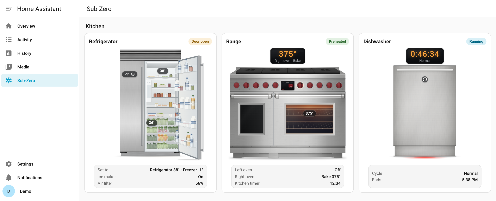
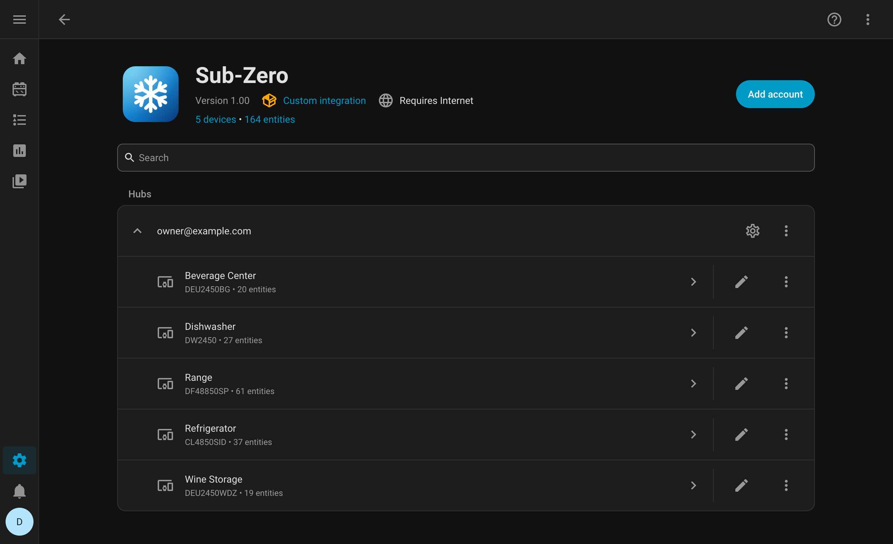
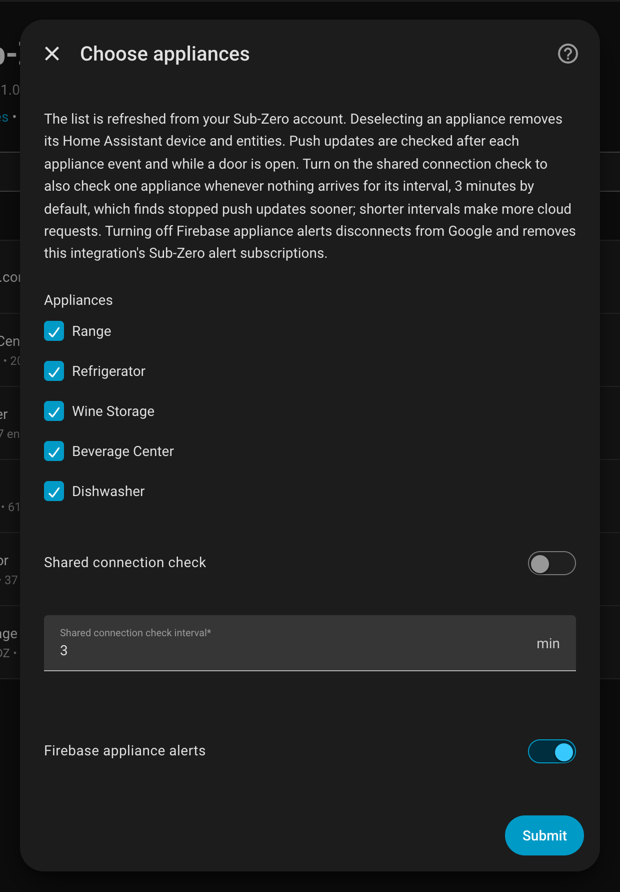
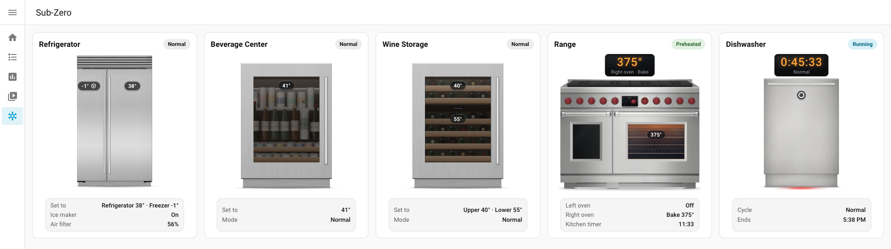
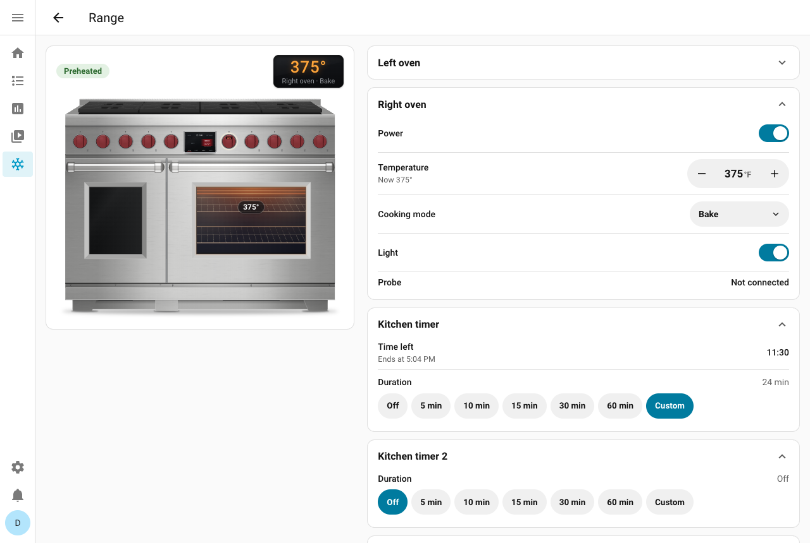
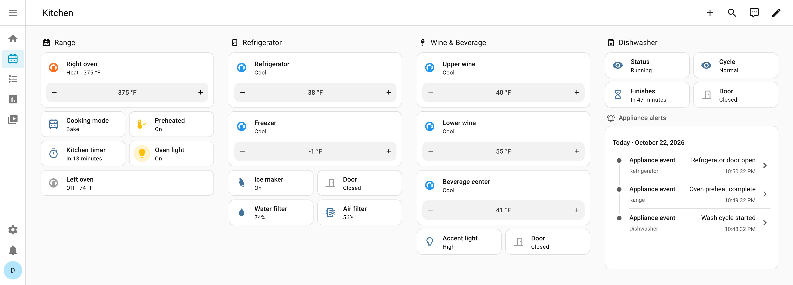
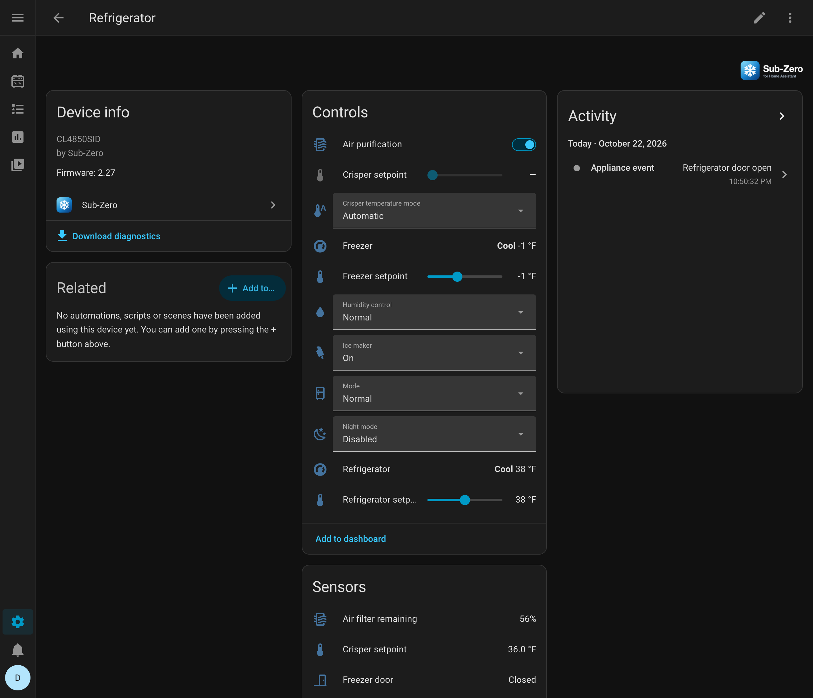
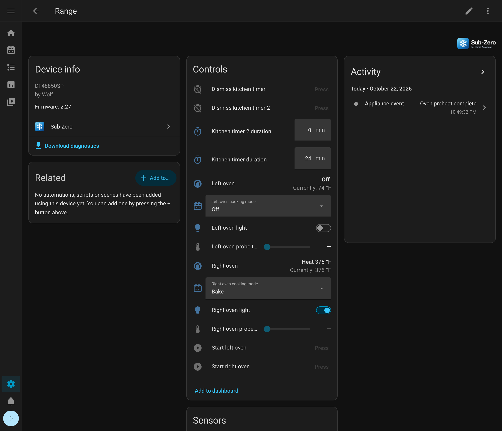
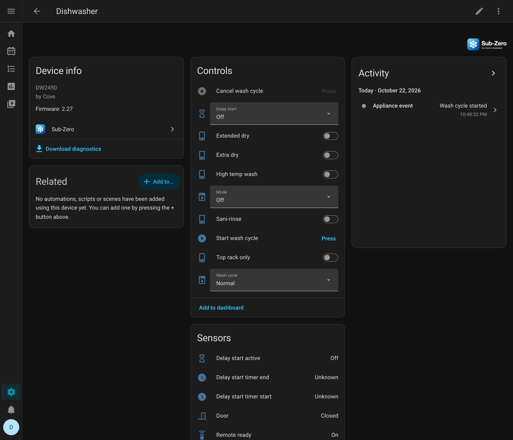
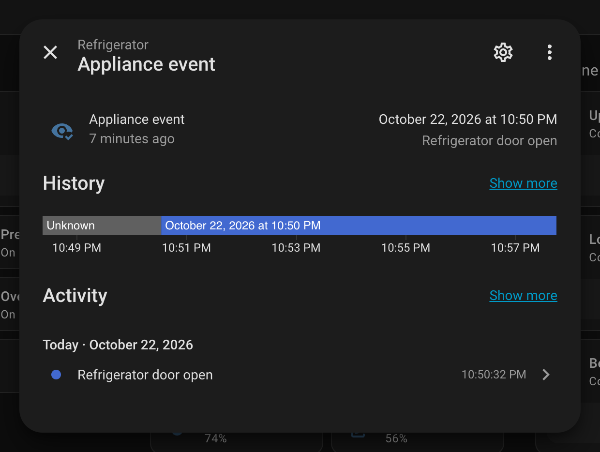

# (Unofficial) Sub-Zero Appliances integration for Home Assistant

[](https://hacs.xyz/docs/faq/custom_repositories/)
[](https://github.com/kedube/ha-subzero/releases)
[](https://github.com/kedube/ha-subzero/actions/workflows/validate.yml)

[](LICENSE)


Monitor and control Sub-Zero refrigerators, freezers, wine storage, and ice makers, Wolf ovens, ranges, and hoods, and Cove dishwashers in Home Assistant.

The integration signs in with your Sub-Zero Group Owner's App account and talks to Sub-Zero's cloud over each appliance's existing Wi-Fi connection. Bluetooth is not needed. Updates are pushed to Home Assistant as they happen.

This is an unofficial integration. It is not affiliated with or endorsed by Sub-Zero Group.

<picture>
  <source media="(prefers-color-scheme: dark)" srcset="docs/images/panel-hero-dark.png">
  
</picture>

**Contents:** [Requirements](#requirements) · [Installation](#installation) · [Setup](#setup) · [Options](#options) · [Sidebar panel](#sidebar-panel) · [Appliances](#appliances) · [Events and automations](#events-and-automations) · [Actions](#actions) · [How live updates work](#how-live-updates-work) · [Diagnostics](#diagnostics) · [Compatibility](#compatibility) · [Privacy and security](#privacy-and-security) · [Getting help](#getting-help) · [Development](#development)

## Requirements

- Home Assistant **2026.8.0** or newer, with [HACS](https://hacs.xyz) for the recommended installation.
- Appliances already connected to Wi-Fi and added to your account in the Sub-Zero Group Owner's App.
- An account in a country the app supports: **Canada, Mexico, and the United States**. See [Sub-Zero's country availability](https://www.subzero-wolf.com/assistance/answers/multi-brand/sub-zero-group-owner-s-app-location-availability).

## Installation

### HACS

[](https://my.home-assistant.io/redirect/hacs_repository/?owner=kedube&repository=ha-subzero&category=integration)

Use the button above, or add the repository yourself:

1. In HACS, open **⋮ → Custom repositories**.
2. Add `https://github.com/kedube/ha-subzero` with the type **Integration**.
3. Download **Sub-Zero**, then restart Home Assistant.

HACS offers each new release as an update. [Release notes](https://github.com/kedube/ha-subzero/releases) list what each one changes, and [CHANGELOG.md](CHANGELOG.md) collects them.

### Manual

Copy the `custom_components/subzero` folder into the `custom_components` folder of your Home Assistant configuration, then restart Home Assistant.

## Setup

1. Open **Settings → Devices & services → Add integration**, and choose **Sub-Zero**.
2. Enter the email and password of your Sub-Zero Group Owner's App account.
3. If your account uses multi-factor authentication, choose a text message or a phone call and enter the code. Sub-Zero may first ask you to type the characters shown in an image.
4. Choose the appliances to add. You can also turn on Firebase appliance alerts here, described in [Events and automations](#events-and-automations).

Each account is one entry, and each appliance becomes a device. Your password is used only to sign in and is never saved. Adding, restarting, or reloading the integration never changes an appliance's settings; settings change only when you use a control or an automation does.



## Options

Open **Settings → Devices & services → Sub-Zero → Configure** to change:

| Option | What it does |
| --- | --- |
| **Appliances** | The appliances to include. The list is refreshed from your account. Removing an appliance removes its device and entities. If the list can't be refreshed, your saved appliances are shown and the other options can still be changed. |
| **Follow-up checks** | On by default. After an event, and while a door is open, checks that live updates are still arriving whenever none have arrived for the interval below. The check two seconds after each event runs either way. See [How live updates work](#how-live-updates-work). |
| **Follow-up check interval** | Minutes without an update before each follow-up check, from 1 to 10. The default is 2. |
| **Shared connection check** | Off by default. Checks that live updates are still arriving whenever none have arrived for the interval below. See [How live updates work](#how-live-updates-work). |
| **Shared connection check interval** | Minutes without any update before that check runs, from 1 to 60. The default is 3. |
| **Firebase appliance alerts** | Off by default. Receives the alerts the phone app gets, such as a door left open. See [Events and automations](#events-and-automations). |
| **Show Sub-Zero in the sidebar** | On by default. Adds the Sub-Zero panel to the sidebar for every user. See [Sidebar panel](#sidebar-panel). |



Home Assistant's own **Enable polling for changes** switch, under the entry's **⋮ → System options**, also applies: turning it off stops every scheduled check, described in [How live updates work](#how-live-updates-work).

## Sidebar panel

The **Sub-Zero** entry in the sidebar shows each appliance as a card with a drawing of it, modeled on the appliance's product photos. The drawing follows the appliance's live state: an open door swings open, a heating oven glows, a running dishwasher counts down. Cards are grouped by area and show the appliance's status, its display, and two or three key readings.

<picture>
  <source media="(prefers-color-scheme: dark)" srcset="docs/images/panel-overview-dark.png">
  
</picture>

Select a card for the full view: every control the appliance has, its recent events, and a **Refresh** button. Controls follow the same rules as the entities, and a locked control says why, for example while Sabbath mode is on, during self-clean, or while a wash runs. Starting an oven or a dishwasher, and canceling a wash, ask first.

<picture>
  <source media="(prefers-color-scheme: dark)" srcset="docs/images/panel-range-dark.png">
  
</picture>

**Appearance.** The model number gives the layout, so the drawing shows a Classic side-by-side or French door, a Designer column, a range's burners and griddle, charbroiler, or French top, or a wall oven's style. What the model doesn't say, an admin sets under **Appearance** in the full view: stainless or a custom panel color, knob color, handle, and an oven's style. If a drawing doesn't match the appliance, choose its form there too. Everyone who opens the panel sees the same Appearance. The default is stainless with red knobs.

The drawings are original illustrations without Sub-Zero, Wolf, or Cove logos. The panel needs no dashboard setup and works in the Home Assistant app on phones. To remove it, turn off **Show Sub-Zero in the sidebar** in Configure.

## Appliances

The integration creates entities only for the properties an appliance reports, so the entities you get depend on the model. There is no list of supported models. When the Sub-Zero app ignores a property for an appliance type, such as the accent light on some refrigerators, the integration ignores it too and leaves out the entities that depend on it.

The entities work like any others in Home Assistant, for example on a dashboard:

<picture>
  <source media="(prefers-color-scheme: dark)" srcset="docs/images/dashboard-dark.png">
  
</picture>

Things that apply to every appliance:

- **Temperatures** work in Celsius and Fahrenheit. Home Assistant shows temperatures and accepts setpoints in your preferred unit. Appliances store setpoints in whole degrees Fahrenheit, so a Celsius setpoint may be rounded.
- **Sabbath mode** blocks every change except turning it off, as the appliance does. While it's on, climate entities, setpoints, switches, buttons, and selects are unavailable. The **Mode** control stays available, so choosing **Normal** (or **Off** on a dishwasher) turns Sabbath mode off. Sensors keep reporting.
- **Active faults** shows the number of active faults, with their codes, severity, and any title and resolution steps Sub-Zero provides. It refreshes every 30 minutes. Faults are cleared at the appliance.
- **Times** keep the offset the appliance reports. A time without an offset is read in the appliance clock's time zone, learned from the clock time it pushes, or in Home Assistant's time zone until it has pushed one.

### Refrigerators, freezers, and wine storage



| Control | Settings |
| --- | --- |
| Temperature setpoints | Refrigerator, refrigerator drawer, freezer, crisper; also as climate entities for thermostat cards |
| Crisper temperature mode | Automatic, Manual |
| Humidity control | Normal, Enhanced; Disabled and Low are shown when the appliance reports them |
| Ice maker | Off, On, Max ice, Night ice |
| Mode | Normal, Sabbath, High use, Short vacation, Long vacation |
| Night mode | Disabled, Enabled |
| Air purification | On, Off |
| Internal water dispenser | On, Off |
| Accent light | Off, Low, Medium, High; Off and On on older built-in models |
| Door open delay | Off, 1, 2, 5, or 10 minutes before an open door sends an alert |
| Reset air filter | A button, on the models the app resets remotely (series 22) |

| Status | Reported |
| --- | --- |
| Setpoints and display temperatures | Refrigerator, refrigerator drawer, freezer, crisper |
| Doors | Refrigerator, refrigerator drawer, freezer |
| Filters | Air and water filter life remaining, water filter capacity in gallons |
| Ice maker | Enabled, Max ice, Night ice, and Max ice start and end times |
| Modes | Sabbath, High use, Short vacation, Long vacation, and High use start and end times |
| Appliance | Service required, power, Wi-Fi signal strength |

- The **Ice maker** control shows the selected mode. In [Night ice](https://www.subzero-wolf.com/assistance/answers/sub-zero/common/sub-zero-night-ice-mode), the separate **Ice maker enabled** status can read Off while the schedule pauses production.
- To adjust the crisper setpoint, choose **Manual** crisper mode first. The manual range stays within 2 °F of the refrigerator setpoint and within the refrigerator's limits. See [Sub-Zero's crisper guide](https://www.subzero-wolf.com/assistance/answers/sub-zero/next-classic/sub-zero-classic-series-cl-refrigerator-drawer-temperature-contr).
- Turn off **Max ice** before changing the freezer setpoint.
- **Reset air filter** sends the reset after you replace the filter. Like the app, the button appears only on models it can reset remotely. On others, such as Classic models, reset the filter at the appliance.
- [Humidity control](https://www.subzero-wolf.com/assistance/answers/sub-zero/next-classic/next-classic-humidity-control) affects the refrigerator zone. [Night mode](https://www.subzero-wolf.com/assistance/answers/sub-zero/next-classic/next-classic-night-mode) dims the interior lights in a dark room and is separate from Night ice.
- Refrigerator temperatures are the configured setpoints. A negative water filter capacity means use beyond the filter's rated capacity.

**Wine storage** has a setpoint from 40–65 °F, a climate entity, a display temperature, and a door for each zone. Two-zone units name them **Upper wine** and **Lower wine**, as the app does. A unit with one door for both zones has a single door sensor. Wine units also get the **Mode** control with the modes the app offers for them, such as Sabbath.

### Dedicated ice makers

Dedicated ice makers have an On and Off ice control and a door open delay setting. They report Sabbath mode, the door, the water filter, the delay schedule, the cleaning stage and next cleaning, and fault and winterization flags.

- **Sub-Zero: Schedule ice delay** pauses production for 1 to 12 hours, now or later today, once or daily. See [Actions](#actions).
- **End current ice delay** resumes production but keeps a repeating schedule. **Cancel ice delay schedule** removes the schedule.
- Cleaning happens at the appliance; the cleaning sensors report its progress.

### Wolf ovens and ranges

Each oven cavity has its own entities. A second cavity's entities start with **Lower oven**. On ranges with two ovens, the cavities are the **Right oven** and **Left oven**, as in the app.



| Type | Reported |
| --- | --- |
| Temperatures | Oven and probe temperatures, oven and probe setpoints, broil level (Low, Medium, High) while broiling |
| Status | Door, cooking, preheated, Remote Ready, probe in use, probe within 10° of target, probe target reached, Gourmet mode |
| Timers | Cooking timer and both kitchen timers: active, under one minute, complete, and start and end times |
| Cooking | Cooking mode, whether the oven allows mode changes, and the Gourmet program, such as Baked potato |
| Appliance | Sabbath mode, service required, Wi-Fi signal strength |

| Control | What it does |
| --- | --- |
| Climate entity | Sets the temperature and turns the cavity on or off. The temperature can change only while the oven is on or in Remote Ready, within the limits of the selected mode, such as 85–110 °F for Proof. |
| Cooking mode | Lists the modes the app offers for that oven and cavity, so some modes appear only on some ovens. Choosing Off turns the cavity off. |
| Start oven | Starts the cavity with the selected mode and temperature. Available only in Remote Ready. |
| Interior light | Turns the cavity light on or off. |
| Probe target | 120–210 °F, with the probe connected and the cavity on or in Remote Ready. |
| Kitchen timers | Two durations from 0 to 719 minutes. Setting one starts or restarts that timer; 0 cancels it. |
| Dismiss kitchen timer | Clears a finished timer, like the app's Tap to Dismiss. |

- Turn on **Remote Ready** at the oven before each remote start; opening the door cancels it. See [Wolf's Remote Ready guide](https://www.subzero-wolf.com/assistance/answers/wolf/m-series-oven/sub-zero-group-owners-app---set-up-remote-access).
- Broil, Convection broil, Proof, Self clean, and Gourmet programs must be started at the oven, including from automations.
- While either cavity self-cleans, the only change allowed is turning it off. The interior light is unavailable during Proof.
- The oven temperature is shown even while the cavity is off. An oven that's off keeps reporting its last reading, so it stays stale until the cavity turns on again. Probe readings show as unknown when no probe is in use.
- The broil level follows the setpoint: Low below 400 °F, Medium from 400 °F, and High from 500 °F.
- An oven series the integration doesn't recognize uses a temperature range of 85–550 °F.

### Wolf ventilation hoods

Hoods have a fan with four speeds and a task light with brightness from 5–100% and white temperature from 2700–5000 K. Other controls include the halo light, automatic fan sensitivity (Off, Low, Medium, High), delayed shutoff from 0 to 719 minutes, button tones, and the control lock. A request outside a range uses the nearest limit. Filter use and allowance are reported as durations; reset the filter counter at the hood.

### Cove dishwashers



| Type | What you get |
| --- | --- |
| Cycle | Wash cycle, wash status, cycle active, and cycle end time |
| Cycle choice | Choose a cycle while the dishwasher is idle |
| Mode | Off, Child lock, Sabbath, while idle |
| Options | Extra dry, Extended dry, High temp wash, Sani-rinse, Top rack only, while idle, for the cycles that offer them |
| Delay start | Off or 1 to 12 hours while idle or delayed, except for Quick and Rinse and hold, with its status and start and end times |
| Status | Door, Remote Ready, rinse aid low, softener salt low, service required |
| Start wash cycle | Starts the cycle, delay, and options set on the dishwasher, when it's in Remote Ready |
| Cancel wash cycle | Available while the dishwasher is running, drying, or delayed, or while a delayed start counts down |

- Choosing a cycle doesn't start it. To allow a remote start, hold **ENTER** on the dishwasher for five seconds, then close the door within four seconds; opening the door cancels Remote Ready. See [Cove's Remote Ready guide](https://www.subzero-wolf.com/assistance/answers/cove/dishwasher/cove-dishwasher-remote-ready-feature).
- Wash status uses the app's words: Idle, Running, Paused, Canceling, Drying, Done, Delayed, and Error.
- As in the app, options are unavailable while a cycle runs and for cycles without them. Rinse and hold has none. High temp wash and Sani-rinse aren't offered for Quick, Crystal and china, Energy, or Extra quiet. Extended dry isn't offered for Quick, Extra dry isn't offered for Crystal and china or Energy, and Top rack only isn't offered for Pots and pans, Soak and scrub, Plastics, or Energy.

## Events and automations

Each appliance has an **Appliance event** entity. It fires for events such as an oven preheating, a probe reaching its target, a timer finishing, a dishwasher cycle starting or ending, a door left open, or a filter needing replacement. Its attributes hold the event type, the numeric code, the sequence number, and the time the appliance reported.



Automations match event types by ID, such as `refrigerator_door_ajar`, which Home Assistant displays as **Refrigerator door open**. A code the integration doesn't know uses the `unknown` type and keeps its number. Event names call a second cavity the lower oven, even on a range.

To trigger on an event, use a **State** trigger on the event entity and check `event_type`. The entity's state changes to the time of each event, so repeated events of the same type trigger every time:

```yaml
triggers:
  - trigger: state
    entity_id: event.kitchen_appliance_event
conditions:
  - condition: template
    value_template: "{{ trigger.to_state.attributes.event_type == 'refrigerator_door_ajar' }}"
actions:
  - action: notify.mobile_app_my_phone
    data:
      message: Refrigerator door open
```

An event says that something happened, not what the appliance's sensors read now. The integration brings the appliance's entities up to date right after each event, but an automation triggered by the event may run first. To act on a current value, call **Sub-Zero: Refresh** before checking it. For example, a reminder sent only if the door is still open ten minutes later:

```yaml
actions:
  - delay:
      minutes: 10
  - action: subzero.refresh
    data:
      device_id: 0123456789abcdef0123456789abcdef  # the refrigerator's device ID
  - condition: state
    entity_id: binary_sensor.kitchen_refrigerator_door
    state: "on"
  - action: notify.mobile_app_my_phone
    data:
      message: Refrigerator door still open
```

An alert about a door left open can arrive after the door has closed, so check the door sensor rather than assume it's still open.

### Firebase appliance alerts

Appliances report events over their live update connection. Turning on **Firebase appliance alerts** adds a second source: the Firebase alerts Sub-Zero sends to the phone app, such as a door left open. Both arrive through the same event entity, and each event fires once, whichever source reports it first.

- The integration registers its own Firebase client and subscribes to the refrigeration, cooking, or dishwasher alerts that apply to each appliance. The phone app's notification settings stay as they are.
- The appliance's **Door open delay** setting still decides when a door alert is sent.
- Firebase credentials are saved in the integration's configuration and reused after a restart. The Firebase library is installed either way, since it's part of the integration.
- Turning the option off, or removing the integration, removes this integration's alert subscriptions. Sub-Zero offers no way to delete the registration itself, so it remains but receives nothing.
- Service and fault alerts that the app handles separately (codes 105, 217, 305, 400, and 401) aren't subscribed through Firebase. They still arrive over the live connection and as fault entities.

### Event timing

- Events from before the integration started are never replayed, so an automation doesn't fire for something that happened while Home Assistant was stopped.
- Repeated reports of the same event are dropped, even after the appliance resets its sequence counter.
- Replay protection relies on the appliance clock. A clock five minutes behind Home Assistant can hide the first five minutes of events after a reload.

## Actions

### Sub-Zero: Refresh

`subzero.refresh` brings the selected appliances up to date right away and returns when it's done. It checks each appliance's live update connection and reads the appliance's state, restoring live updates if they had stopped. If a check is already running, the action waits for it instead of starting another.

| Field | Description |
| --- | --- |
| `device_id` | One or more Sub-Zero appliances |

### Sub-Zero: Schedule ice delay

`subzero.schedule_ice_delay` pauses a dedicated ice maker.

| Field | Description |
| --- | --- |
| `device_id` | The ice maker |
| `duration` | Hours to pause, from 1 to 12 |
| `start_in` | Minutes until the pause begins, from 0 to 1439. 0 starts it now. |
| `repeat` | Repeat the pause every day |

## How live updates work

All the appliances on an account share one live connection to Sub-Zero's cloud. Each appliance pushes its full state when the connection opens, then each change as it happens. Nothing is polled on a timer by default.

Sometimes the cloud stops delivering updates for a while, for every appliance at once, even though the connection stays open. A door could then stay open in Home Assistant after it has closed. To catch this, the integration checks the connection at the moments a missed update matters most. A check asks one appliance to resend its full state, the same way the Sub-Zero app does each time it opens:

- **After an event**, two seconds later, so the appliance's entities catch up with whatever caused it. With **Follow-up checks** on, for the next 10 minutes another check runs whenever the follow-up check interval, 2 minutes by default, passes without an update, since state often changes again soon after an event: a door closes, a timer is dismissed, a cycle moves on.
- **While a door is open**, with **Follow-up checks** on, whenever the follow-up check interval passes without an update, for up to 15 minutes. A door open longer is probably open on purpose.
- **With the shared connection check on**, whenever the whole connection goes the chosen interval without any update. Each of these checks takes the appliance checked least recently.
- **When the Refresh action runs.**

If the appliance doesn't answer within 16 seconds, the integration reads its state directly and reconnects, which usually restores updates for every appliance. The connection is also renewed at least every 50 minutes, which brings every appliance up to date.

Appliances that are busy sending updates need no checks, since each update shows the connection works. A status read the integration makes for another reason, such as confirming a control, doesn't delay a check.

**Cloud requests.** Sub-Zero publishes no request limit. Each check is one request, plus one more when the appliance doesn't answer. With nothing happening, the integration makes none. An event or a door left open adds at most one check per follow-up check interval for 10 or 15 minutes: up to 5 or 8 at the default 2 minutes, and none with **Follow-up checks** off. The shared connection check adds one per interval while the connection is quiet: up to 20 an hour at the default 3 minutes, or 60 at 1 minute. If Sub-Zero asks the integration to slow down, it waits as long as asked, and updates keep arriving in the meantime.

**Turning off Enable polling for changes** stops the follow-up checks, the open-door checks, the shared connection check, and the 30-minute fault refresh. A new event still gets its one check.

**Controls are confirmed from the appliance.** After a change, the integration waits for the appliance to report the new value, trying up to three times, eight seconds each. If the appliance still doesn't report it, the change fails with the last error the cloud gave. Changes the app makes in a fixed order, such as an oven start or an ice mode change, are sent in that order.

## Diagnostics

**Diagnostic sensors.** Wi-Fi signal strength is enabled by default. Uptime, IP address, MAC address, and live reporting mode are available but disabled; enable them in the entity settings. Appliances shorten their uptime to eight characters, so past 100 hours it's accurate to ten seconds, and past 1,000 hours to the minute.

**Diagnostics downloads.** Download diagnostics from the integration's page or from a device's page. They contain the appliances' cached state and the integration's counters, without your account credentials, appliance names, serial numbers, or network identifiers. They also list property names the integration doesn't recognize yet, without their values. Counters start over whenever the integration reloads, including after a change in Configure.

The integration download shows:
- the follow-up check and shared connection check settings and intervals, and whether **Enable polling for changes** is off;
- how many live messages arrived, and how many were ignored or couldn't be read;
- the Firebase listener's status, its last subscription sync, and how many alerts arrived;
- the last 10 connections: when each started and ended, and why it ended (`lifetime`, `renewal`, `closed`, or an error);
- whether the sidebar panel is on and in the sidebar.

Each appliance's download shows its state, how the panel draws it (the layout read from its model number, and its Appearance), and these counters:

| Field | Meaning |
| --- | --- |
| `snapshots`, `updates`, `last_received` | Full states and changes received, and when the last arrived |
| `channel_reopens` | Checks of every kind |
| `alert_checks`, `watch_checks`, `connection_checks`, `manual_checks` | Checks after an event, follow-up and open-door checks, shared connection checks, and Refresh actions |
| `silent_channels` | Checks the appliance didn't answer within 16 seconds |
| `connection_renewals` | Reconnects those silent checks caused |
| `check_reads`, `skipped_reads` | Checks that compared state, and reads skipped because Sub-Zero asked to slow down |
| `missed_updates`, `unpushed_changes` | Door changes, and changes to any property, that a check found before an update reported them |
| `recent_checks` | The last 20 checks: time, reason, result, how long the answer took, whether it reconnected, and how late an answer came after the check stopped waiting |
| `recent_silent_channels`, `recent_connection_renewals` | The times of the last 10 of each. The same times on several appliances mean the whole connection went quiet. |

**Debug logging.** Turn on debug logging for `custom_components.subzero` to record connection attempts, message types, state changes, door changes that updates missed, and checks and reconnects. Logged values leave out network identifiers.

## Compatibility

These appliances have been used with the integration:

- Sub-Zero CL4850SID refrigerator
- Sub-Zero DEU2450BG undercounter beverage center
- Sub-Zero DEU2450WDZ dual-zone wine storage
- Wolf DF48850SP dual-fuel range with two ovens
- Cove DW2450 dishwasher

Wolf wall ovens, ventilation hoods, and dedicated ice makers are supported from the app's behavior and tested with simulated appliances, but not yet with real ones. Other models work when the cloud reports their state; their entities depend on what they report.

Setup, Configure, the actions, event names, and the sidebar panel are translated into German, French, Dutch, Spanish, Simplified Chinese, Italian, Polish, and Swedish. Entity names are in English. The translations were machine-assisted, and corrections from native speakers are welcome.

Not supported: local network control, multi-factor methods other than text message or phone call, and accounts that sign in through another provider.

## Privacy and security

- Your password is used only to sign in and is never stored. Home Assistant stores renewable account tokens and refreshes them on its own. If they can't be renewed, Home Assistant asks you to sign in again.
- Protect your Home Assistant backups as you would other account credentials, since they contain those tokens.
- The integration uses the Sub-Zero Group Owner's App's cloud service and app settings. A change on Sub-Zero's side, such as to sign-in or the app's key, can need an integration update.

## Getting help

[Open an issue](https://github.com/kedube/ha-subzero/issues) with your Home Assistant version, the integration version, your appliance model, and the steps that lead to the problem. Say whether the same thing works in the Sub-Zero app, and attach a diagnostics download and any `custom_components.subzero` log messages. Remove account details and tokens from logs before posting them.

## Development

[PROTOCOL.md](PROTOCOL.md) describes Sub-Zero's cloud API, the live update connection, Firebase alerts, and the appliance properties, with the source of each detail.

With Python 3.14:

```sh
python -m venv .venv
.venv/bin/pip install -r requirements-test.txt
.venv/bin/pytest
.venv/bin/ruff check .
.venv/bin/ruff format --check .
```

The sidebar panel is in [frontend/](frontend/), written in TypeScript with Lit. With Node 22 or newer:

```sh
cd frontend
npm ci
npm run check   # type check, tests, and the bundle
node scripts/render.mjs --out /tmp/drawings --module range   # drawings to PNGs, with Chrome
```

The build writes `custom_components/subzero/frontend/subzero-panel.js`. It's committed, because the integration serves it as is, so commit it with every change to the panel's source.

The **Validate** workflow runs the tests and lint against each supported Home Assistant version, plus hassfest, the HACS check, and the panel's checks, including that the committed bundle matches its source, on every push and pull request.

### Releases

The **Release** workflow publishes a release once those checks pass. Start one in either of two ways:

- Push a commit to `main` that changes `version` in [manifest.json](custom_components/subzero/manifest.json).
- Run the **Release** workflow from the Actions tab and enter the version. It commits the version to `main` for you.

Versions have two decimal places and go up by 0.01: 1.00, 1.01, up to 1.99, then 2.00. Tags use the bare version, such as `1.01`, with no `v`. A new version must be higher than every existing tag, including the earlier `v0.x.y` tags. There are no pre-releases, because Home Assistant doesn't accept a version such as `1.01b1`.

The workflow tags the release, attaches the `ha_subzero.zip` that HACS downloads, and writes the notes from the commits since the previous release. Pushing a version tag yourself also works if it matches manifest.json, and pushing a tag that already has a release replaces its zip.

## License & Credit

MIT; see [LICENSE](LICENSE). This integration began as a fork of [orienw/ha-subzero](https://github.com/orienw/ha-subzero).
